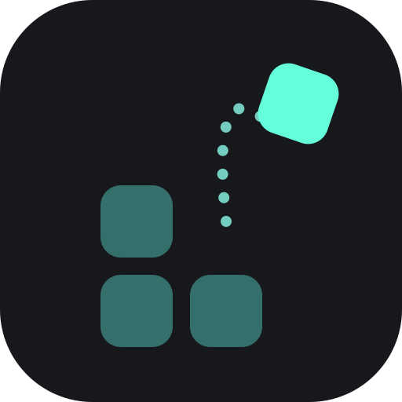
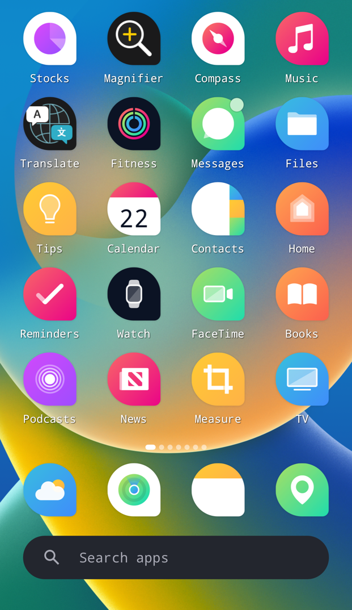
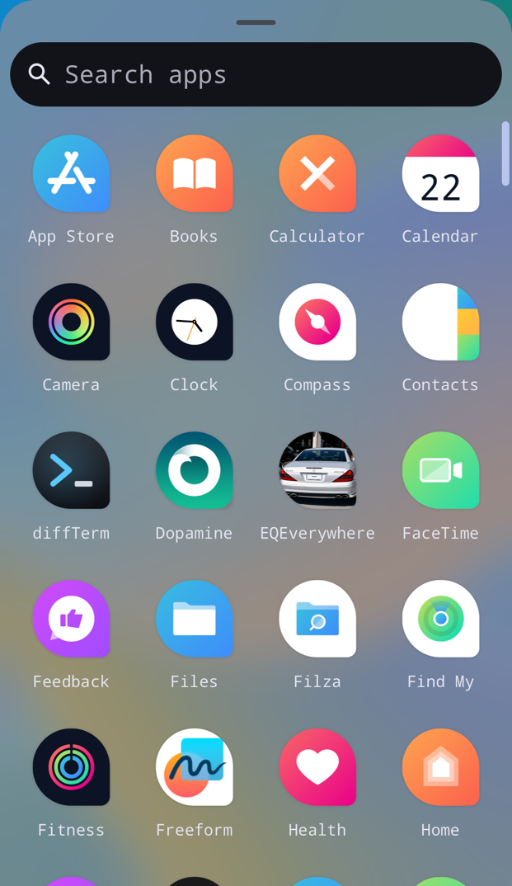
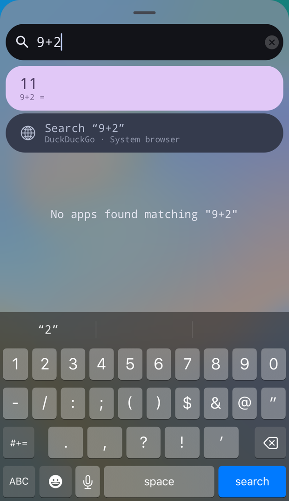
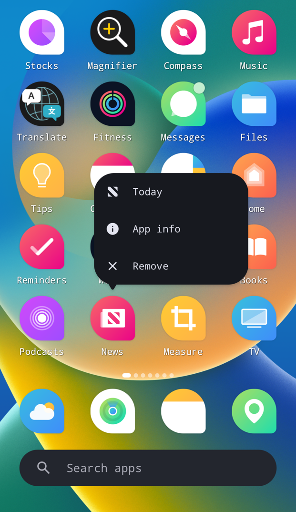
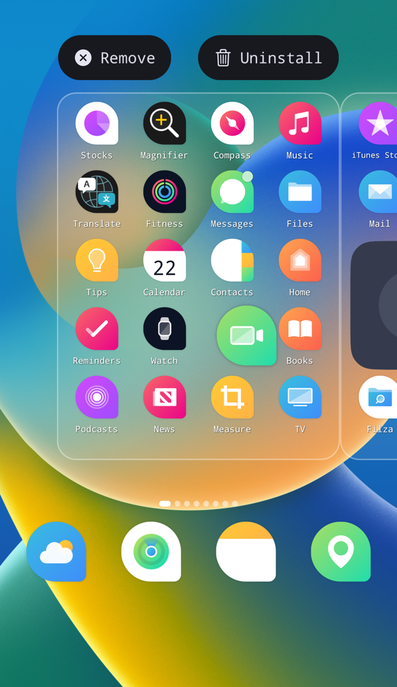
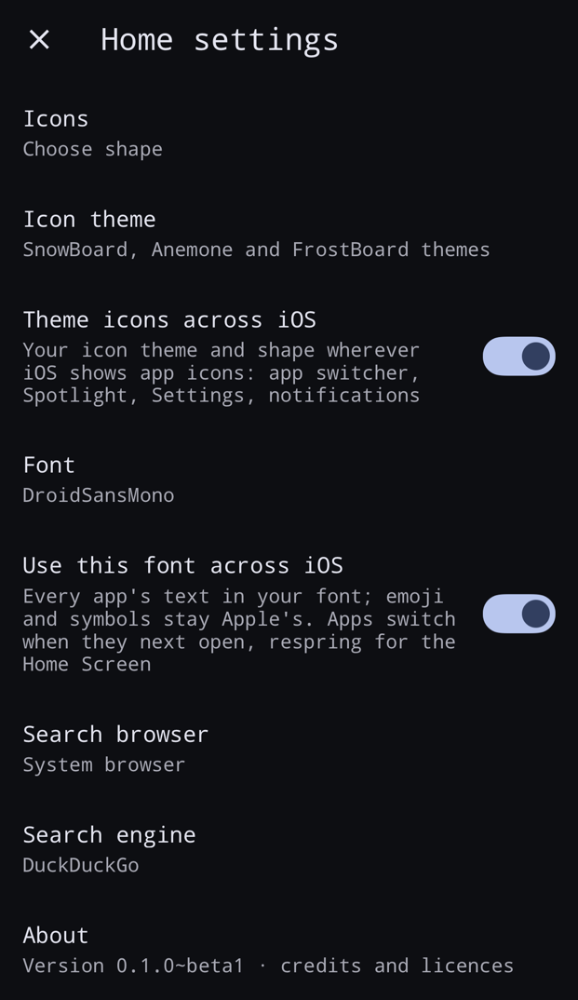

# Catapult

**Make your iPhone's Home Screen work like Android's.** 
Catapult swaps the iOS Home Screen for Trebuchet, the one from LineageOS. Everything else stays iOS.

**[Website](https://jond-ie.github.io/repo/catapult/)** · **[Download](../../releases)** · **[Sileo repo](https://jond-ie.github.io/repo)** · **[Report a bug](../../issues)** · **[X @Jond_ie](https://x.com/Jond_ie)**

  
  

### What you get
- **An app drawer.** Swipe up for every app in one A to Z list. Its search box also does quick sums, converts units and searches the web.
- **A tidier Home Screen.** Folders open on one page, and widgets show the time, weather, your music and your batteries (AirPods too).
- **Your look.** Icon shapes, icon themes and your own font, on the Home Screen or across all of iOS. Emoji stay Apple's.
- **In your language.** Catapult follows your iPhone's language.
- **It still feels like an iPhone.** Apps open and close with Apple's own animation, straight from their icon.

> **Safe to try.** If something goes badly wrong, Catapult switches itself off and your normal Home Screen comes back.

This repo holds the downloads and the bug tracker. Catapult's source code isn't published.

---

## Install

Add **`https://jond-ie.github.io/repo`** in Sileo or Zebra and search **Catapult**. Or download the `.deb` from **[Releases](../../releases)**.

- Needs a **rootless jailbreak** (Dopamine, palera1n…) on **iOS 15 to 18**.
- **iOS 14, rootful (experimental):** a separate test build is on the [Releases](../../releases) page. It hasn't been tested on a real iOS 14 phone yet.
- Had MakrSas's Trebuchet? Catapult replaces it and keeps your layout.

**[Everything it can do, tested phones and questions →](https://jond-ie.github.io/repo/catapult/)**

## Bugs and ideas
Open an **[issue](../../issues)** with your iPhone, iOS version and what happened.

---

<b>Credits and licences</b>

- **[MakrSas](https://github.com/MakrSas)**: the original Trebuchet port to iOS that Catapult is built on ([MakrSas/Trebuchet](https://github.com/MakrSas/Trebuchet), Apache 2.0), plus LineageQS and Material You. Thank you.
- **LineageOS and the Android Open Source Project**: Trebuchet and Launcher3 (layouts, grids, folders, app drawer, icon shapes, motion and artwork), Apache 2.0.
- **Roboto Flex** by Google, SIL Open Font License.

Catapult is a modified version of MakrSas's port. The full notices and licences are in [third-party/](third-party/) and come installed with the package.

